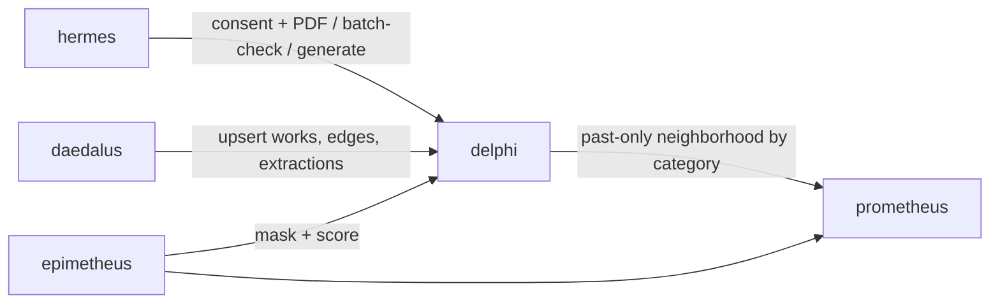

# delphi-engine

Workspace for a system that proposes **research paths** and **patent whitespaces** from the literature you already have — global catalogs plus a local library — and tests those proposals by **hindcasting**.

Given only papers and patents published before time *T*, can an AI propose the next plausible innovation in that space? If the proposal resembles what actually happened (or a useful gap that did not), the system is doing its job. If it cannot, a larger graph will not save it.

A **working prototype** is: the user consents to upload a PDF, the system extracts information (including categories and subcategories), and the user queries the **next research path** or the **next patent opportunity** in those categories. Hindcasting on the same field is how we know the generator is not guessing at random.

This repository currently holds every component as an **isolated folder**. GitHub Issues, CI, and analog pins live at the workspace root. Each folder is shaped like a standalone pirlruc package so it can become its own git repository later ([SCALE-003](docs/issues.yml)).

## Methodology

[GitHub Issue-native ADR](https://github.com/pirlruc/methodologies/tree/1.2.1/github-issue-adr) — Epic = decision record, optional Y-statement, no ADR markdown files. Templates: [pirlruc/github-scaffold](https://github.com/pirlruc/github-scaffold) @ **1.2.0**. Quality: pin [pirlruc/guardrails](https://github.com/pirlruc/guardrails) at `docs/guardrails/` @ **1.3.0**. Applies to **new issues only**.

TypeScript/Tauri gates for Hermes desktop are a **proposal** in [`docs/proposal/guardrails/`](docs/proposal/guardrails/) until they are copied into pirlruc/guardrails ([TOOL-002](docs/issues.yml)).

Authored backlog: [`docs/issues.yml`](docs/issues.yml).

```bash
bash scripts/setup-issue-scaffold.sh
bash scripts/issues-sync.sh --repo pirlruc/delphi-engine --yaml docs/issues.yml --validate-only
bash scripts/issues-sync.sh --repo pirlruc/delphi-engine --yaml docs/issues.yml --dry-run
```

Creating labels, milestones, and issues needs a GitHub token with **Issues: Read and write**. Publishing issues is gated — dry-run first.

## Components

| Folder | Role in the product |
| --- | --- |
| [`contracts/`](contracts/) | Shared Pydantic models and OpenAPI. The only package other folders may depend on. |
| [`delphi/`](delphi/) | Catalog and query API. Batch identifier checks, PDF accept after consent, category-filtered generate. |
| [`daedalus/`](daedalus/) | Ingest (OpenAlex + patent slice of the named field) and PDF extraction. |
| [`prometheus/`](prometheus/) | Generates `research_path` or `patent_whitespace` from a **masked** past-only neighborhood. |
| [`epimetheus/`](epimetheus/) | Hindcasting eval harness. Temporal masks must not leak the future. |
| [`hermes/`](hermes/) | User client. Prototype: Python CLI with consented PDF upload. Product: Tauri + Zotero. |



## Plan in one page

**Phase 0** — decisions (`SYS-001` … `SYS-009`, `GATE-001`): folder isolation, Postgres+pgvector, identity, consented PDF upload, six components, cloud **and** local LLM adapters, dual audience, category query axis. First corpus: **transformers/FMs, bounded computer vision, steganography, 2D codes** ([SYS-009](docs/issues.yml), [`docs/prototype-corpus.md`](docs/prototype-corpus.md)). CI is **manual** (`workflow_dispatch` only).

**Phase 1 — prototype** — contracts, Delphi REST, ingest of those four subcategories (papers + patents, with caps), PDF extraction, Prometheus generate by kind+category, leak-proof hindcasting, Hermes CLI. Done when `PROTO-007` has both the PDF demo and eval numbers.

**Phase 2 — product slice** — wider patent coverage, queued extraction at scale, embeddings, Tauri+Zotero, fuzzy matching, HITL.

**Phase 3 — scale-out** — split graph/vector engines when measured, streaming ingest, extract folders into standalone repos.

## Analog pins

| Companion | How it is pinned |
| --- | --- |
| `pirlruc/guardrails` | Git submodule SHA at `docs/guardrails/` (tag **1.3.0**) |
| `pirlruc/github-scaffold` | Git submodule SHA at `.github/scaffold/` (tag **1.2.0**) |
| `pirlruc/methodologies` | Cited by tag (`tree/1.2.1/github-issue-adr`). Not a submodule. |

Private clones need `CURSOR_REPO_READ_TOKEN` (or equivalent) at VM start. `.gitmodules` uses HTTPS URLs without tokens.

## CI

GitHub Actions is **manual** ([GATE-001](docs/issues.yml)): Actions → `quality` → Run workflow. There is no `push` / `pull_request` / `schedule` trigger.

```bash
bash scripts/check-ci-local.sh
```

## Documentation

- [`docs/prototype-corpus.md`](docs/prototype-corpus.md) — what “field” means and why ingest waits
- [`docs/proposal/guardrails/`](docs/proposal/guardrails/) — proposed TS-* pack
- [`docs/ai-agent-handoff.md`](docs/ai-agent-handoff.md)
- [`docs/issues.yml`](docs/issues.yml)
- [`docs/limitations.md`](docs/limitations.md)
