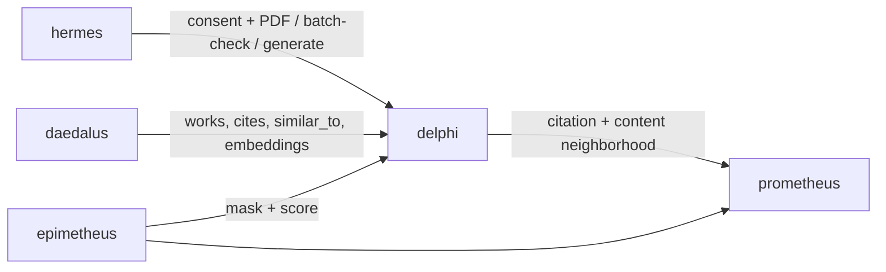

# delphi-engine

Workspace for a system that proposes **research paths** and **patent whitespaces** from the literature you already have — global catalogs plus a local library — and tests those proposals by **hindcasting**.

Given only papers and patents published before time *T*, can an AI propose the next plausible innovation in that space? If the proposal resembles what actually happened (or a useful gap that did not), the system is doing its job. If it cannot, a larger graph will not save it.

A **working prototype** is: the user consents to upload a PDF; the system extracts **title, authors, keywords**, bibliography, and body text; it attaches that work to a **citation graph** (this paper’s cites plus catalog citations) and a **content graph** (similarity to **other papers’** text in the slice); then the user queries the **next research path** or **next patent opportunity** in a subcategory. Hindcasting on the same slice is how we know it is not guessing.

This repository currently holds every component as an **isolated folder**. GitHub Issues, CI, and analog pins live at the workspace root. Each folder is shaped like a standalone pirlruc package so it can become its own git repository later ([SCALE-003](docs/issues.yml)).

## How to run the prototype

One-shot go/no-go (sample PDF → dual graphs → both generate kinds → slice hindcast). Writes [`docs/prototype-demo.json`](docs/prototype-demo.json):

```bash
export PATH="$HOME/.local/bin:$PATH"
bash scripts/demo-prototype.sh
```

Long-running API (in-memory catalog, SYS-009 fixture, Fake LLM):

```bash
bash scripts/serve-prototype.sh
```

Postgres 16 + API (Compose). Sets `DELPHI_DATABASE_URL` and still defaults to Fake LLM:

```bash
docker compose up --build
curl -s http://127.0.0.1:8000/health
```

Live OpenAlex pages for the four subcategories (small cap, not tens of thousands):

```bash
cd daedalus
uv run daedalus --live --per-subcategory 5 --output /tmp/oa-slice.json
# then: bash scripts/serve-prototype.sh --records /tmp/oa-slice.json
```

In another terminal (fixture seed `11111111-1111-1111-1111-111111111111`):

```bash
cd hermes
uv run hermes batch-check --doi 10.1000/qr-2014
uv run hermes upload paper.pdf --subcategory two_d_codes --consent-destination delphi
uv run hermes neighborhood 11111111-1111-1111-1111-111111111111 --subcategory two_d_codes --mode union
uv run hermes generate research_path --subcategory two_d_codes --seed-work-id 11111111-1111-1111-1111-111111111111
uv run hermes generate patent_whitespace --subcategory two_d_codes --seed-work-id 11111111-1111-1111-1111-111111111111
```

Hindcast artifact (Fake judge):

```bash
cd epimetheus
uv run epimetheus --output evalrun.json
uv run epimetheus --works-json ../daedalus/src/daedalus/fixtures/slice.json --output docs/prototype-eval.json
```

Optional Postgres 16 + pgvector with the API (Compose). Unit tests use `DELPHI_TEST_DATABASE_URL` when a local server is up:

```bash
docker compose up --build
```

## Methodology

[GitHub Issue-native ADR](https://github.com/pirlruc/methodologies/tree/1.2.1/github-issue-adr) — Epic = decision record, optional Y-statement, no ADR markdown files. Templates: [pirlruc/github-scaffold](https://github.com/pirlruc/github-scaffold) @ **1.2.0**. Quality: pin [pirlruc/guardrails](https://github.com/pirlruc/guardrails) at `docs/guardrails/` @ **1.3.0**. Applies to **new issues only**.

TypeScript/Tauri gates for Hermes desktop are a **proposal** in [`docs/proposal/guardrails/`](docs/proposal/guardrails/) until they are copied into pirlruc/guardrails ([TOOL-002](docs/issues.yml)).

Authored backlog: [`docs/issues.yml`](docs/issues.yml).

```bash
bash scripts/setup-issue-scaffold.sh
bash scripts/issues-sync.sh --repo pirlruc/delphi-engine --yaml docs/issues.yml --validate-only
bash scripts/issues-sync.sh --repo pirlruc/delphi-engine --yaml docs/issues.yml --dry-run
```

Creating labels, milestones, and issues needs a GitHub token with **Issues: Read and write**. Publishing issues is gated — dry-run first.

## Components

| Folder | Role in the product |
| --- | --- |
| [`contracts/`](contracts/) | Shared Pydantic models and OpenAPI. The only package other folders may depend on. |
| [`delphi/`](delphi/) | Catalog API. Dual graph: `cites` and `similar_to`. Batch-check, consented PDF, category-filtered generate. |
| [`daedalus/`](daedalus/) | Ingest OpenAlex + patent slice; extract PDF metadata/bibliography/body; embed catalog and uploads. |
| [`prometheus/`](prometheus/) | Generates `research_path` or `patent_whitespace` from a **masked** past-only neighborhood. |
| [`epimetheus/`](epimetheus/) | Hindcasting eval harness. Temporal masks must not leak the future. |
| [`hermes/`](hermes/) | User client. Prototype: Python CLI with consented PDF upload. Product: Tauri + Zotero. |



## Plan in one page

**Phase 0** — decisions (`SYS-001` … `SYS-010`, `GATE-001`): folder isolation, Postgres+pgvector, identity, consented PDF upload, six components, cloud **and** local LLM adapters, dual audience, category query axis, **citation + content graphs**. First corpus: **transformers/FMs, bounded computer vision, steganography, 2D codes** ([SYS-009](docs/issues.yml), [`docs/prototype-corpus.md`](docs/prototype-corpus.md)). Dual-graph rules: [`docs/prototype-graphs.md`](docs/prototype-graphs.md). CI is **manual** (`workflow_dispatch` only).

**Phase 1 — prototype** — contracts, Delphi REST, ingest of those four subcategories (papers + patents, with caps), PDF metadata extraction, **citation graph + content graph against other papers**, Prometheus generate by kind+category, leak-proof hindcasting on both graphs, Hermes CLI. Done when `PROTO-007` has both the PDF demo and eval numbers.

**Phase 2 — product slice** — wider patent coverage, queued extraction at scale, richer catalog text for content-graph re-embed, Tauri+Zotero, fuzzy matching, HITL.

**Phase 3 — scale-out** — split graph/vector engines when measured, streaming ingest, extract folders into standalone repos.

## Analog pins

| Companion | How it is pinned |
| --- | --- |
| `pirlruc/guardrails` | Git submodule SHA at `docs/guardrails/` (tag **1.3.0**) |
| `pirlruc/github-scaffold` | Git submodule SHA at `.github/scaffold/` (tag **1.2.0**) |
| `pirlruc/methodologies` | Cited by tag (`tree/1.2.1/github-issue-adr`). Not a submodule. |

Private clones need `CURSOR_REPO_READ_TOKEN` (or equivalent) at VM start. `.gitmodules` uses HTTPS URLs without tokens.

## CI

GitHub Actions is **manual** ([GATE-001](docs/issues.yml)): Actions → `quality` → Run workflow. There is no `push` / `pull_request` / `schedule` trigger.

```bash
bash scripts/check-ci-local.sh
```

Python package gates (ruff, mypy, interrogate, pytest with 95% coverage) run as part of that script unless `SKIP_PYTHON_GATES=1`. Directly: `bash scripts/python-gates.sh`.

## Documentation

- [`docs/prototype-corpus.md`](docs/prototype-corpus.md) — four subcategories and ingest bounds
- [`docs/prototype-graphs.md`](docs/prototype-graphs.md) — citation graph and content graph
- [`docs/eval-rubric.md`](docs/eval-rubric.md) — judge scores
- [`docs/prototype-demo.json`](docs/prototype-demo.json) — last Fake-LLM demo artifact
- [`docs/proposal/guardrails/`](docs/proposal/guardrails/) — proposed TS-* pack
- [`docs/ai-agent-handoff.md`](docs/ai-agent-handoff.md)
- [`docs/issues.yml`](docs/issues.yml)
- [`docs/limitations.md`](docs/limitations.md)
